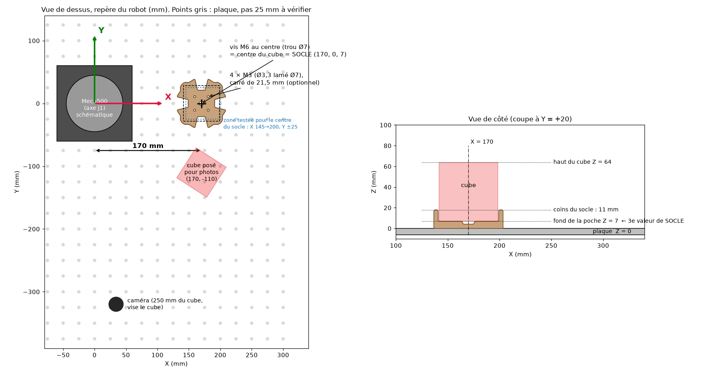

# Guide de montage du socle



## 1. Le repère du robot (où se mesurent les positions)
Toutes les positions du code sont dans le **repère de la base du Meca500**, en mm :
- **origine** : le centre de la base, c'est-à-dire l'axe de rotation de J1, au niveau du dessous de
  la base (= la plaque) ;
- **X** : la direction vers laquelle le bras pointe quand toutes les articulations sont à 0°
  (le « devant » du robot) ;
- **Y** : vers la gauche quand on regarde dans la direction X (vu depuis le robot) ;
- **Z** : vers le haut, Z = 0 sur la plaque.

Astuce : dans MecaPortal, mets J1 à 0°. Le bras indique alors la direction X ; sur la plaque,
la rangée de trous qui passe sous le centre de la base et sous la bride est l'axe X (Y = 0).

## 2. Où visser le socle
- **Position prévue par le code** : centre de la poche à **X = 170 mm, Y = 0**, socle posé directement
  sur la plaque. Le cube repose alors à Z = 7 mm.
- **Fixation** : le socle a un **trou Ø7 au centre** (pour une **vis M6** dans un trou taraudé de la
  plaque), exactement sous le centre du cube. Le trou de la plaque que tu choisis est donc le point
  `SOCLE`. Les 4 trous Ø3,3 lamés (vis M3, carré de 21,5 mm) sont en plus, si tu veux bloquer la
  rotation avec des vis M3 dans une autre plaque ou des inserts.
- **Orientation** : les côtés de la poche parallèles aux axes X et Y (les ouvertures au milieu des
  faces tournées vers le robot, vers l'extérieur, à gauche et à droite). Les 4 orientations à 90°
  sont équivalentes.
- **Si 170 ne tombe pas sur un trou** (pas de la plaque de 25 mm, et la position du robot sur la
  plaque compte) : prends le trou le plus proche sur la rangée Y = 0, mesure sa distance au centre
  de la base, et mets cette valeur dans `SOCLE` (étape 3). Le robot est à l'aise si le centre du socle
  est entre **X = 145 et 200 mm** et **Y = −25 à +25 mm** (zone vérifiée en cinématique ; au-delà de
  190 la marge diminue). Ne mets rien sous le socle, sinon change aussi Z (étape 3).

## 3. Où changer la position du socle dans le code
Un seul endroit : **`meca500_rubiks/reglages.py`**, ligne `SOCLE` :

```python
SOCLE = (170.0, 0.0, 7.0)    # centre du fond de la poche : (X, Y, Z) en mm
```
- **X, Y** : coordonnées du trou de la vis M6 (centre du socle) dans le repère du robot ;
- **Z** : hauteur du fond de la poche, où repose le cube = **7** si le socle est posé sur la plaque
  (+ l'épaisseur d'une cale si tu en mets une dessous).

La simulation RoboDK reprend automatiquement cette valeur (`simulation/parametres.py` la lit).
Même chose pour le point de pose des photos (`TABLE`) et la caméra, dans le même fichier.

## 4. Vérifier sur le vrai robot, SANS le cube
Main sur l'arrêt d'urgence, vitesses par défaut (lentes).

1. **`python placer_socle.py`** : le robot amène la pince ouverte là où le code attend le cube,
   patins à mi-hauteur du cube. À cette hauteur tout l'outil est 5 mm au-dessus des coins du socle :
   il ne peut pas le toucher (si Z est juste).
   - Les deux patins doivent être **centrés sur les ouvertures gauche et droite** de la poche
     (vu depuis le robot), bout des doigts vers le robot.
   - Sinon, décale au clavier : `x 2` (2 mm plus loin du robot), `x -2`, `y 2` (vers la gauche),
     `y -2`… Quand c'est centré, tape `ok` : le script affiche la ligne `SOCLE = (...)` à recopier
     dans `reglages.py`. (`q` pour quitter sans rien changer.)
   - Tu peux aussi t'en servir pour poser le socle : pince en place, glisse le socle dessous,
     centre-le sur les patins, puis visse.
2. **`python piloter_robot.py verifier_outil`** : la pince ouverte descend juste au-dessus d'un cube
   posé (patins 10 mm au-dessus de son haut), pause 10 s. Rien ne doit toucher.
3. Puis, avec le cube, **`python piloter_robot.py prendre_et_reposer`**, un mouvement à la fois.

## 5. Après chaque changement de `SOCLE` (ou de `TABLE`)
1. Reconstruis la station RoboDK : ouvre `Rubiks_Meca500.rdk`, puis **Tools > Run Script >
   00_Rubiks_Meca500** (ou configuration PyCharm « 7 - Reconstruire la station »).
2. Relance les tests : `.venv/bin/pytest -m robodk` (cinématique + collisions de chaque mouvement,
   RoboDK ouvert). Tout doit être vert avant d'essayer sur le vrai robot.
